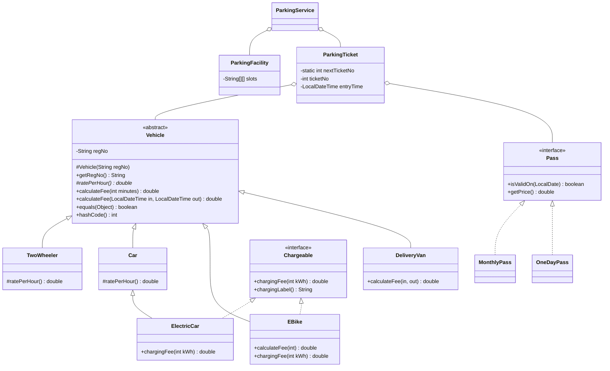

# Task 6 – UML class diagram (Mermaid – paste into https://mermaid.live or GitHub renders it)

EBike, DeliveryVan and OneDayPass are the Task 12 additions.
Inheritance types: Vehicle -> Car -> ElectricCar is **multilevel**; Vehicle -> {TwoWheeler, Car} is **hierarchical**.
